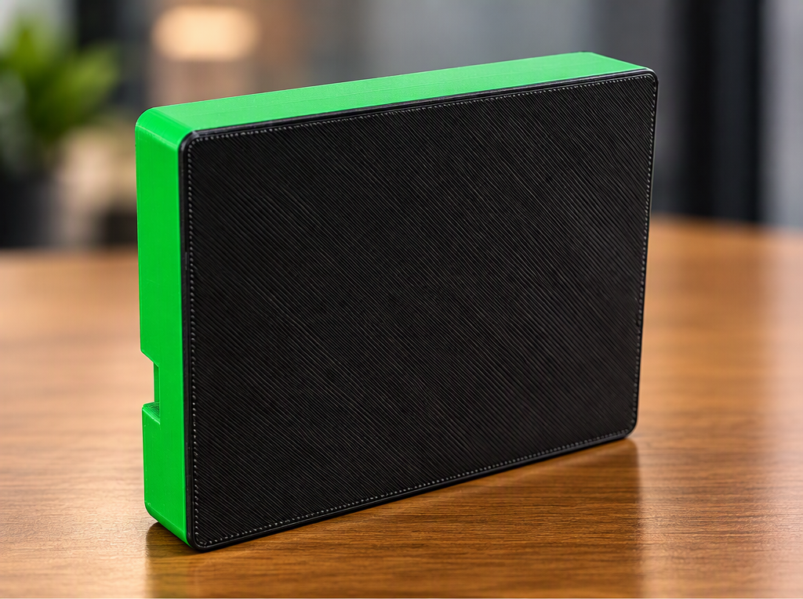

# Matt's BLE Tracker

## ESP32-S3 Bluetooth Low Energy Scanner and Proximity Tracker

Matt's BLE Tracker is a portable ESP32-S3 Bluetooth Low Energy scanning and tracking device with a touchscreen interface, device discovery, tracking functionality, status indicators, and onboard logging capabilities.

The project is designed as a compact field tool for Bluetooth and wireless research, testing, and development.

## Features

- ESP32-S3 based platform
- Bluetooth Low Energy scanning
- BLE device discovery
- Device tracking
- Touchscreen user interface
- On-device status display
- Status LED indicators
- Portable enclosure
- Expandable hardware architecture
- Field-oriented design

## Hardware

Hardware documentation, wiring information, component details, and enclosure information are located in the `hardware/` directory.

## Firmware

Firmware and source code are located in the `firmware/` directory.

## Documentation

Additional project documentation is located in the `docs/` directory.

## Project Images

### Front

### Back

## Repository Structure

- `docs/` - Project documentation
- `firmware/` - ESP32-S3 firmware and source code
- `hardware/` - Hardware, wiring, components, and enclosure information
- `images/` - Product and project images
- `LICENSE` - MIT License
- `README.md` - Main project README

## Development Status

Matt's BLE Tracker is under active development.

Hardware, firmware, user interface, and enclosure designs may continue to change as new features are developed and tested.

## License

This project is licensed under the MIT License.

See the `LICENSE` file for details.
