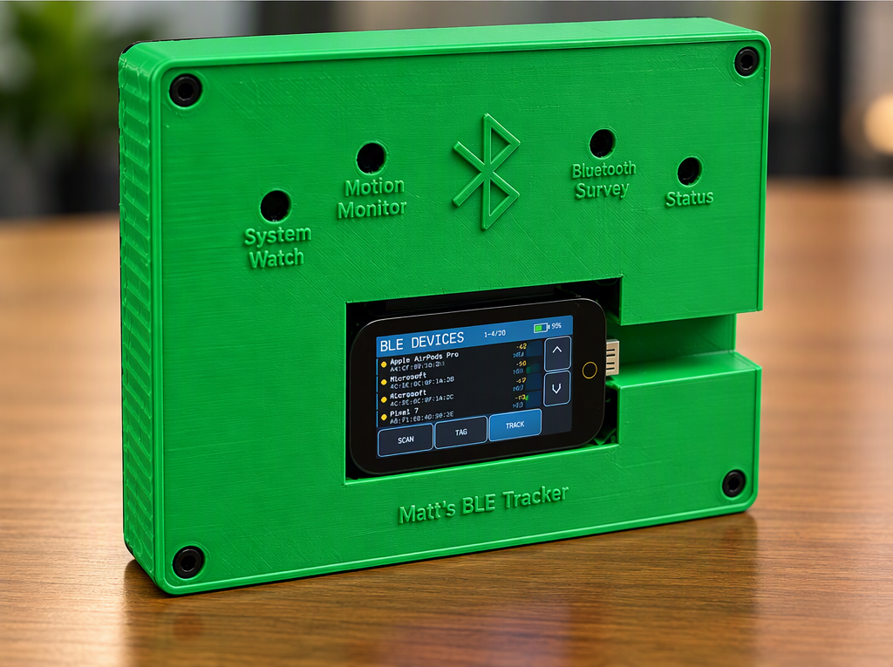

# Matt's BLE Tracker

Matt's BLE Tracker is a portable ESP32-S3 based Bluetooth Low Energy scanning, identification, and proximity tracking platform.

The project is built around the LILYGO T-Display-S3 Touch, a custom carrier PCB, external indicator LEDs, LiPo battery, and a custom 3D-printed enclosure.

## Current Firmware

Current stable release:

**ESP32PocketRF_v3_8_Intelligence**

Previous known-good firmware is retained in the firmware archive.

## Features

- Active Bluetooth Low Energy scanning
- Complete Local Name parsing
- Shortened Local Name parsing
- BLE scan-response processing
- Manufacturer identification
- Intelligent fallback device names
- Device-type recognition
- Known/New device tagging
- Device Details view
- RSSI proximity tracking
- RSSI trend graph
- Automatic BLE rescanning
- Touchscreen navigation
- Three proximity LEDs
- Dedicated STATUS LED
- Battery monitoring
- Display power management
- Deep-sleep power management
- Wake from either physical button

## Hardware

- LILYGO T-Display-S3 Touch
- ESP32-S3
- 1.9-inch capacitive touchscreen
- Custom carrier PCB
- Four external indicator LEDs
- LiPo battery
- Custom 3D-printed enclosure

## GPIO Assignments

| Function | GPIO |
|---|---:|
| WEAK proximity LED | 11 |
| MED proximity LED | 12 |
| STRONG proximity LED | 13 |
| STATUS LED | 43 |
| Physical Button 1 | 0 |
| Physical Button 2 | 14 |
| Display Power | 15 |
| Battery Monitor | 4 |
| Touch SDA | 18 |
| Touch SCL | 17 |
| Touch Interrupt | 16 |
| Touch Reset | 21 |

## BLE Device Naming

The firmware attempts to identify BLE devices using:

1. Complete Local Name
2. Shortened Local Name
3. Scan-response Local Name
4. Manufacturer plus abbreviated BLE address
5. Abbreviated BLE address

Some BLE peripherals do not broadcast their user-assigned name. In those cases, the fallback identifier is expected behavior.

## Proximity Tracking

A selected BLE device can be monitored using RSSI signal strength.

The tracking 
